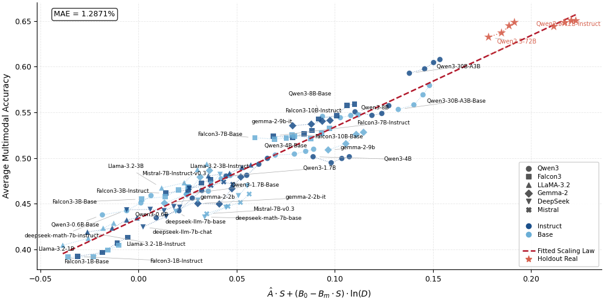

# Capability-Driven Scaling Laws

**EMNLP 2026 Main Conference (Oral)**

This repository provides the implementation and resources for reproducing the experiments of **Capability-Driven Multimodal Scaling Laws**.

**Paper:** [What Transfers from Text to Vision? Capability Scaling Laws and Transfer Dynamics for VLMs](https://arxiv.org/abs/2608.00013)

### 🔗 Resources

- 📄 **Paper:** [arXiv](https://arxiv.org/abs/2608.00013)
- 🌐 **Project Website:** [CDMScaling](https://wangq-dev.github.io/CDMScaling-Website/)
- 🤖 **Model Weights:** [ModelScope](https://modelscope.ai/profile/wangq2k)
- 💻 **Inference Code:** [CDMScaling-Inference](https://github.com/wangq-dev/CDMScaling-Inference)

## Overview

The Capability-Driven Multimodal Scaling Law predicts vision-language model (VLM) performance across diverse large language model (LLM) families before training by linking measurable textual capability from LLM benchmarks with the amount of multimodal training data. It models how efficiently textual skills transfer to multimodal tasks and how effectively additional data improves performance. Validated on over 150 VLMs built from 34 LLMs across 7 families, the law enables accurate extrapolation from small to large models, prediction of full training trajectories, and generalization to unseen families. It also uncovers benchmark biases, shows base LLMs often outperform instruction-tuned variants, and maps distinct family positions in the transfer–absorption space. This turns backbone selection from costly trial-and-error into a principled, quantitative process.

<div align="center">
  
</div>

## Model Weights and Inference

The trained VLM checkpoints and inference implementation are available separately:

- **Model Weights:** Trained VLM checkpoints are hosted on [ModelScope](https://modelscope.ai/profile/wangq2k).
- **Inference Code:** Inference scripts and usage instructions are provided in [CDMScaling-Inference](https://github.com/wangq-dev/CDMScaling-Inference).

Please refer to the inference repository for instructions on loading the released checkpoints and running inference.

## Repository Structure

The main files and directories are organized as follows:

```
.
├── assets/
│   └── main_pic.png
│
├── eval_results/
│   ├── text_accuracy.csv
│   ├── multimodal_accuracy.csv
│   ├── text_accuracy_all.csv
│   ├── multimodal_accuracy_all.csv
│   └── text_benchmark_count.csv
│
├── fit_law_across_32_LLM_backbones.ipynb
├── validate_transfer.ipynb
├── validate_absorption.ipynb
│
├── requirements.txt
└── README.md
```

Descriptions of key components:

- `eval_results/`
  - Contains all evaluation results required for fitting and validating the scaling law.
  - `text_accuracy.csv`: Text benchmark results used for scaling law fitting.
  - `multimodal_accuracy.csv`: Multimodal benchmark results used for scaling law fitting.
  - `text_accuracy_all.csv`: Complete text evaluation results.
  - `multimodal_accuracy_all.csv`: Comprehensive multimodal evaluation results covering 264 model checkpoints (32 LLM backbones with 8 checkpoints each, plus 2 additional backbones with 4 checkpoints each).
  - `text_benchmark_count.csv`: Sample counts for each text evaluation benchmark.

- `fit_law_across_32_LLM_backbones.ipynb`
  - Fits the Capability-Driven Multimodal Scaling Law using textual and multimodal evaluation results.

- `validate_transfer.ipynb`
  - Validates the transfer relationship between textual capabilities and multimodal performance.

- `validate_absorption.ipynb`
  - Validates the capability absorption behavior during multimodal scaling.

## Reproduction Steps

Follow the steps below to reproduce the main experimental results.

### Step 1: Clone the Repository

Clone this repository and enter the project directory:

```bash
git clone https://github.com/wangq-dev/CDMScaling.git
cd CDMScaling
```

### Step 2: Set Up the Environment

Create the conda environment:

```bash
conda create -n cdmscaling python==3.10.14
conda activate cdmscaling
```

Install dependencies and register the conda environment as a Jupyter kernel:

```bash
pip install -r requirements.txt
python -m ipykernel install --user --name cdmscaling --display-name "Python (cdmscaling)"
```

### Step 3: Check Evaluation Results

All required evaluation results are provided in:

```bash
eval_results/
```

The notebooks directly load these files for scaling law fitting and validation.

No additional preprocessing is required.

### Step 4: Fit the Capability-Driven Scaling Law

Run:

```bash
fit_law_across_32_LLM_backbones.ipynb
```

This notebook:

1. Loads textual and multimodal evaluation results.
2. Processes benchmark scores.
3. Fits the Capability-Driven Multimodal Scaling Law.
4. Generates the corresponding results and visualizations.

### Step 5: Validate Capability Transfer

Run:

```bash
validate_transfer.ipynb
```

This notebook evaluates whether textual capabilities can predict multimodal performance across different model backbones.

### Step 6: Validate Capability Absorption

Run:

```bash
validate_absorption.ipynb
```

This notebook analyzes how additional multimodal training data improves model performance and validates the capability absorption behavior predicted by the scaling law.

## Output

After running all notebooks, the generated results and figures will reproduce the main experimental findings.

The notebooks provide the complete pipeline from loading evaluation results to generating final analysis results.

## Citation

If you find this repository useful, please cite our paper:

```bibtex
@misc{li2026transferstextvisioncapability,
      title={What Transfers from Text to Vision? Capability Scaling Laws and Transfer Dynamics for VLMs},
      author={Ziran Li and Qiang Wang and Zhengyu Chen and Shanglin Lei and Borun Chen and Jingang Wang and Xunliang Cai},
      year={2026},
      eprint={2608.00013},
      archivePrefix={arXiv},
      primaryClass={cs.CL},
      url={https://arxiv.org/abs/2608.00013},
}
```
